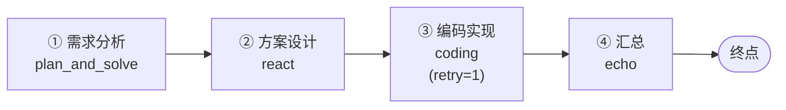
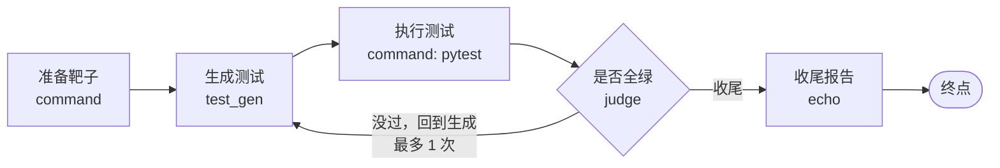
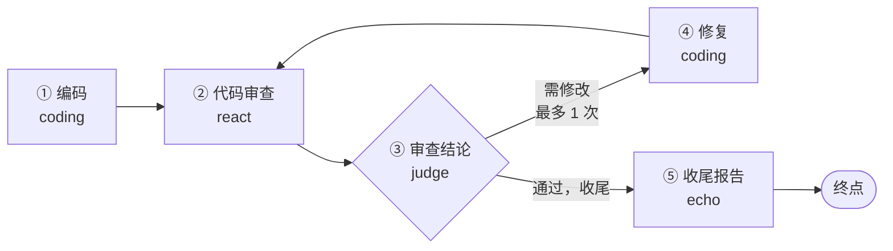

# Workflow MVP 设计文档（Homework 2）

> 课程：软件工程　作业：Homework 2 · Simple Workflow MVP
> 学号姓名：2412190418　吴咏翰
> 仓库：<https://github.com/Ling345/agentcode-workflow>
> 项目1（Homework 1）：<https://github.com/Ling345/myagent>　设计文档留档在
> [`docs/design-homework1.md`](docs/design-homework1.md)
> 交付物：源码仓库（本目录）、本文档 [`Design.md`](Design.md)、[`README.md`](README.md)；
> 演示视频为可选提交物，录制脚本见第 8 节。

---

## 1. 作业要求与完成情况

### 1.1 必须实现的

| 要求 | 怎么做的 | 证据 |
| --- | --- | --- |
| 至少 2 个 Agent 协作完成一个完整流程 | 三条内置流程：`mini_se`（4 个智能体：需求/设计/编码/汇总）、`test_pipeline`（`test_gen` + 命令节点 + 判定节点 + 汇总）、`code_review`（编码/审查/修复三个角色） | `tests/test_workflow_library.py::test_every_builtin_flow_uses_at_least_two_agents` |
| 实现 Agent 间的消息传递或状态共享 | `WorkflowState`：键值共享状态。上游节点的产出按 `output` 键写进去，下游节点的任务模板用 `${变量}` 取用；每次写入都记录来源（哪个节点写的） | `tests/test_workflow_state.py`、`tests/test_workflow_engine.py::test_a_sequential_workflow_passes_state_between_two_agents` |
| 支持基本流程控制（顺序执行） | 节点之间用连线（`Edge`）连起来，引擎按"波次"顺序推进；没有条件时就是一条直线 | `test_mini_se_is_a_requirements_design_code_pipeline` |
| MVP 可运行即可，不需要复杂调度 | 没有引入任何第三方编排框架、没有消息队列、没有数据库新表：一个图 + 一个执行器 + 一个线程池 | `agentcode/workflow/` 全部代码约 1400 行（含注释） |

### 1.2 推荐实现的（都做了）

| 推荐项 | 怎么做的 |
| --- | --- |
| 条件分支 | 连线上的 `when` 条件成立才走；普通节点取"第一条成立的边"，没走的支路会在记录里标成 `skipped` 并写明原因 |
| 循环 | 指回前面节点的连线就是循环；靠 `Edge.max_times`（这条边最多走几次）、`Node.max_visits`（这个节点最多跑几次）、`Workflow.max_steps`（整条流程最多几步）三道上限兜底，不会转不停 |
| 并行执行 | 节点上标 `parallel=True`，它的多条出边会一起走，这些目标构成同一波次并发执行；波次之间仍然有确定顺序 |
| 可视化 Workflow 编排界面 | 网页 `/workflow`：左边选流程，中间把流程图（节点 + 连线条件）画成卡片列表，运行起来每个节点实时变色（SSE 推送），右边是历史运行，点一条能看当时的节点状态与共享状态 |
| 执行日志与状态追踪 | 每个节点都有自己的状态机与耗时记录（`NodeRun`）；整条流程落盘成一个 JSON（`traces/workflows/<run_id>.json`），CLI 用 `workflow runs` / `workflow log` 回看 |
| 错误处理与恢复机制 | 节点可配 `retry`（失败重试，可带退避）；`on_error="continue"` 让流程带伤继续，最终状态标成 `partial` 并写明原因；默认 `stop` 则整条流程失败退出；命令节点还会把退出码与 stderr 记进状态 |
| 复用项目1 的 Agent | 节点不重新实现智能体：直接按名字用项目1 的注册表（`default_registry`），执行走项目1 的事件流 `run_stream`（同一套模型、中间件、token 预算与工具装配），命令节点走项目1 的代码执行后端（`local` / `docker`） |

### 1.3 评分点对照

| 维度（权重） | 对应实现 |
| --- | --- |
| 流程完整性 40% | 三条端到端流程；`test_pipeline` 在离线模式下会**真的写出测试文件并真的跑 pytest**（不是打印假结果）；流程结束有明确状态（`succeeded` / `partial` / `failed`） |
| Agent 协作 30% | 状态是唯一的通信通道；每个节点写入状态都留下"谁写的、什么时候、写了什么"；`workflow log` 与网页都能看到状态快照 |
| 可扩展性 20% | 加节点/连线/条件只改流程定义；换智能体只改 `agent=` 一个字段；执行器（调模型、跑命令）可替换，因此编排逻辑与具体模型解耦 |
| 文档 10% | 本文档（含架构图与流程图）、`README.md` 的 Workflow 一节、`docs/workflow.md`（使用与扩展手册） |

---

## 2. 架构

### 2.1 分层

```mermaid
flowchart TB
    subgraph 界面层
        CLI["CLI：agentcode workflow list/show/run/runs/log"]
        WEB["网页 /workflow：流程图 + 实时状态 + 历史运行"]
    end
    subgraph 编排层
        LIB["流程库 library.py<br/>mini_se / test_pipeline / code_review"]
        ENGINE["引擎 engine.py<br/>波次推进 · 分支 · 循环 · 并行 · 重试"]
        MODEL["定义 model.py<br/>Workflow / Node / Edge"]
        STATE["共享状态 state.py<br/>键值 + 写入历史 + ${变量} 替换"]
        STORE["记录 store.py<br/>运行落盘 / 回看"]
        LIVE["在线运行 live.py<br/>事件流（SSE 用）"]
    end
    subgraph 执行层（复用项目1）
        AGENT["智能体注册表 default_registry<br/>react / plan_and_solve / coding / test_gen / echo"]
        RUNNER["run_stream：模型 + 中间件 + 工具"]
        SANDBOX["代码执行后端：local / docker"]
    end
    CLI --> ENGINE
    WEB --> LIVE --> ENGINE
    CLI --> LIB
    ENGINE --> MODEL
    ENGINE --> STATE
    ENGINE --> STORE
    ENGINE -->|agent 节点| RUNNER --> AGENT
    ENGINE -->|command 节点| SANDBOX
```

### 2.2 五个概念

| 概念 | 位置 | 职责 |
| --- | --- | --- |
| `Workflow` | `model.py` | 一张图：起点 + 节点列表 + 步数上限。构造时会校验（重名节点、指向不存在的连线、起始节点是否存在） |
| `Node` | `model.py` | 一个节点：`agent`（调智能体）/ `command`（跑一段 Python，例如 pytest）/ `judge`（只判断，把布尔值写进状态）/ `end`（终点标记） |
| `Edge` | `model.py` | 一条连线：`when` 条件、`label` 说明、`max_times` 上限（循环就靠它收口） |
| `WorkflowState` | `state.py` | 共享状态：加锁的键值表 + 写入历史 + `${变量}` 模板替换；`snapshot()` 给的是副本 |
| `WorkflowEngine` / `FlowRun` | `engine.py` | 执行器与运行记录：节点状态、耗时、产出、错误、用了多少 token，全都记在 `FlowRun.nodes` 里 |

### 2.3 目录

```
agentcode/workflow/
├── model.py     流程定义（Workflow / Node / Edge）与校验
├── state.py     共享状态与 ${变量} 模板
├── runners.py   执行器：调智能体（复用 run_stream）与跑命令（复用代码执行后端）
├── engine.py    引擎：波次推进、分支、循环、并行、重试、事件
├── library.py   三条内置流程
├── store.py     运行记录落盘与回看
└── live.py      在线运行（网页实时看进度）
agentcode/web/static/workflow.html / workflow.js   可视化界面
tests/test_workflow_*.py, test_cli_workflow.py, test_web_workflow.py   62 项测试
```

---

## 3. 三条内置流程

### 3.1 `mini_se`：需求 → 设计 → 编码 → 汇总（顺序）



每个节点的任务里都带着上一个节点的产出（`${requirements}`、`${design}`），这就是
"Agent 之间的消息传递"。换顺序、加一个"测试"节点，都只需要改这张图。

### 3.2 `test_pipeline`：生成测试 → 执行 → 没过就回到生成（条件 + 循环）



- 命令节点 `on_error="continue"`：**测试没过是预期内的结果**，不该让流程直接失败，
  而是交给判定节点决定"再来一轮"还是"收尾"；
- 回边带 `max_times=1`：最多回头一次，避免"改了还是不过"时无限循环；
- 命令节点把 `退出码`、`输出`、`是否成功` 三个值写进共享状态（`result_exit` /
  `result` / `result_ok`），判定节点就读 `result_ok`。

### 3.3 `code_review`：编码 → 审查 → 需修改就修复并复审（条件 + 循环）



审查智能体被要求最后一行写「结论：通过」或「结论：需修改」，判定节点据此分流——
这是"让 Agent 的输出可被程序判断"的最小做法；真实场景里更好的做法是要求模型输出结构化
JSON（见第 9 节限制）。

---

## 4. 关键设计决策

**1）流程是"图"，不是"步骤列表"。**
作业要求顺序执行，但推荐项里写了条件分支、循环、并行。这三个用一张图表达最自然：
顺序是普通连线，分支是带条件的多条连线，循环是回边，并行是 `parallel=True`。
如果一开始只写"一个列表 for 循环跑一遍"，后面加分支就得重写。

**2）节点之间只通过共享状态通信，不传对象引用。**
好处是：状态随时可以 dump 出来给人看（网页与日志都用它）；并行分支同时写状态也不会互相踩
（`WorkflowState` 加锁）；节点可以单独测试（给个状态字典就能跑）。

**3）"波次"执行模型。**
一次波次 = 一组可以同时跑的节点；波次内并发、波次之间按连线顺序。这样
"并行分支"和"确定性的执行顺序"能同时成立，也不必引入调度器。

**4）条件用 Python 函数，不自造表达式语言。**
`Edge(when=lambda state: state.get("result_ok") is True)`——不用写解析器、不怕注入，
调试时直接打断点；展示给用户看的名字放在 `label` 里（网页与 CLI 显示的就是它）。

**5）执行器可替换（`agent_runner` / `command_runner`）。**
引擎只关心"节点怎么推进"，不关心"这个节点是调模型还是跑命令"。带来的直接好处是
62 项测试全部离线、不依赖模型输出漂移；也方便以后换成别的模型或别的执行方式。

**6）复用项目1，不重复造轮子。**
智能体、工具、中间件、token 预算、代码执行沙箱（本地/容器）全部沿用项目1；
本作业新增的只有"编排"这一层。这样两个作业的成果是同一条技术路线上的两段，
而不是两份互不相干的代码。

**7）失败不静默。**
节点失败会记错误、记重试次数；流程带伤跑完标 `partial`；没走的支路标 `skipped` 并写明原因；
命令节点记退出码与 stderr；运行记录原子写盘（先写临时文件再替换），不会留下半截 JSON。

**8）防止"跑不完"与"跑飞"。**
三重上限（`max_times` / `max_visits` / `max_steps`）+ 明确的终点节点：如果图里画了终点
却没走到，流程会判失败并提示"可能有一条分支没有出口"——这是最容易出的编排 bug。

---

## 5. 节点类型与状态约定

### 5.1 节点类型

| `kind` | 做什么 | 需要填的字段 | 产出写到状态 |
| --- | --- | --- | --- |
| `agent` | 把任务交给指定智能体 | `agent`、`task`（支持 `${变量}`） | `output` ← 智能体的答案 |
| `command` | 在工作目录里跑一段 Python（退出码 0 算成功） | `code`（支持 `${变量}`） | `output` ← 输出；`output_ok` ← 是否成功；`output_exit` ← 退出码 |
| `judge` | 只做判断，不调模型 | `cond` | `output` ← 布尔值 |
| `end` | 终点标记，不干活 | — | — |

### 5.2 状态机

```
节点：pending → running → ok / failed / skipped
流程：succeeded（全绿）｜partial（有节点失败但流程走到了终点）｜failed（中途失败退出 / 超过步数 / 没走到终点）
```

---

## 6. 使用方法

### 6.1 命令行

> 下面的 `python` 指你自己机器上的解释器（3.10 以上）；先在仓库根目录执行
> `python -m pip install -r requirements.txt` 装依赖。

```powershell
python -m agentcode workflow list                     # 有哪些流程
python -m agentcode workflow show test_pipeline       # 节点与连线（含条件标签）

# 离线演示：不需要密钥、不花钱（默认就是 mock）
python -m agentcode workflow run test_pipeline --llm mock
python -m agentcode workflow run mini_se --input request="写一个计算器" --llm mock

# 真实模型
python -m agentcode workflow run mini_se --input request="写一个计算器" --llm openai

# 回看
python -m agentcode workflow runs
python -m agentcode workflow log <run_id>
```

`workflow run` 的退出码：`0` = 成功（含 `partial`），`1` = 失败——可以直接放进 CI 当门禁。

### 6.2 网页

```powershell
python -m agentcode open     # 打开 http://127.0.0.1:8000/workflow
```

第一次启动时账号库是空的，服务会自动建一个管理员账号并把密码**只打印一次**在控制台
（形如 `已创建初始账号　用户名：admin　密码：xxxxxxxx`）。想自己开账号：
`python -m agentcode user add 你的名字 --password 你的密码`。

页面三栏：左边选流程；中间是流程图（每个节点一张卡，跑起来会实时变色，跳过的会标原因）；
右边是最近运行，点一条即可回看当时的节点状态与共享状态快照。

### 6.3 离线演示能跑到什么程度

- `test_pipeline`：**真的**在工作目录里写出 `calculator.py` 与 `test_calculator.py`，
  **真的**跑 `pytest`（命令节点），结果是真实的退出码——这是最推荐的演示路径；
- `mini_se` / `code_review`：流程会完整跑完（节点、状态传递、分支判断都真实发生），
  但离线模式用的是项目1 的脚本模型，**内容是演示假数据**。想看到真实内容就加 `--llm openai`。

---

## 7. 怎么扩展

**加一个节点**（例如在 Mini SE 流水线末尾加"生成测试"）：

```python
Node(
    name="tests",
    title="⑤ 生成测试",
    agent="test_gen",              # 换成别的智能体只改这一行
    task="为刚才的代码生成 pytest 测试：${code}",
    output="tests",
    retry=1,
    edges=(Edge("done"),),
)
```

**加一条流程**：

```python
from agentcode.workflow import Edge, Node, Workflow
from agentcode.workflow.library import register_workflow

register_workflow(Workflow(
    name="my_flow",
    title="我的流程",
    description="一句话说明它干什么",
    nodes=(
        Node(name="a", agent="react", task="先做 A：${request}", output="a", edges=(Edge("b"),)),
        Node(name="b", agent="echo", task="汇总：${a}", output="b"),
    ),
))
```

**换成别的执行方式**（例如把智能体换成自己实现的函数）：给 `WorkflowEngine` 传
`agent_runner`，签名是 `(agent 名, 任务文本, 选项) -> AgentOutput`。

---

## 8. 测试与验证

### 8.1 自动化测试

```powershell
python -m pytest -q          # 全量 935 项（含工作流 62 项）
```

| 测试文件 | 覆盖什么 |
| --- | --- |
| `tests/test_workflow_state.py`（8 项） | 状态读写、快照隔离、`${变量}` 替换、写入历史、并发写入不丢 |
| `tests/test_workflow_engine.py`（18 项） | 顺序传递、条件分支与跳过留痕、循环与三重上限、并行与汇合、重试、`stop`/`continue` 两种错误策略、事件流、构造期校验 |
| `tests/test_workflow_library.py`（11 项） | 三条内置流程的形态与端到端跑通（含"没过 → 回到生成 → 再跑一次"） |
| `tests/test_workflow_store.py`（6 项） | 运行记录落盘/读取/列表/标签 |
| `tests/test_workflow_live.py`（4 项） | 在线运行的事件推送与历史补发 |
| `tests/test_cli_workflow.py`（8 项） | `list/show/run/runs/log`，其中一项**离线端到端**：真的生成测试文件并跑 pytest |
| `tests/test_web_workflow.py`（7 项） | 页面、流程清单、流程图接口、在线运行 SSE、运行记录 |

### 8.2 真机演练

按项目惯例，功能做完要在真实环境里走一遍（不是"应该能跑"）：

1. 起真实服务：`agentcode web --llm mock --port 8798`，浏览器打开 `/workflow`；
2. 选 `test_pipeline` → 运行 → 节点依次变绿，`执行测试` 节点显示真实退出码；
3. `agentcode workflow runs` 能看到这次运行，`workflow log <run_id>` 能看到每个节点的产出与共享状态；
4. `code_review` 用真实模型（`--llm openai`）跑一轮，审查结论为"需修改"时能看到
   `修复 → 复审` 的循环轨迹。

### 8.3 演示视频脚本（可选提交物，1 分钟内）

| 时间 | 做什么 | 说什么 |
| --- | --- | --- |
| 0:00-0:08 | `agentcode workflow show test_pipeline` | "一条流程就是一张图：节点是智能体或命令，连线上的条件就是分支和循环。" |
| 0:08-0:15 | 打开 `/workflow`，指着流程图 | "网页上能看到这张图，跑起来每个节点会实时变色。" |
| 0:15-0:40 | 点运行，等 `test_pipeline` 跑完 | "生成测试的智能体先写测试，命令节点真的跑 pytest，判定节点决定收尾还是回到生成。" |
| 0:40-0:52 | `agentcode workflow log <run_id>` | "每一步的产出、耗时、状态都记在运行记录里，共享状态可以回看。" |
| 0:52-1:00 | 指着 `code_review` 的回边 | "把 `coding` 换成别的智能体、或者加一个节点，只要改流程定义，不用动引擎。" |

---

## 9. 已知限制

1. **并行分支没有显式 join 节点**：同一波次的节点全部结束后才进入下一波；如果要
   "任意一个完成就继续"这类语义，需要再加节点类型。
2. **流程定义不可序列化**：条件写成了 Python 函数（换来的是简单与安全），所以流程定义
   不能直接存成 JSON/YAML；给界面用的是 `to_dict()` 的展示结构。
3. **审查结论靠文本约定**：`code_review` 判断"需修改"是匹配审查文本里的关键词。
   真实生产里应让模型输出结构化结果（JSON）再判断。
4. **网页工作流页面的用量控制比较粗**：跑之前查额度、按账号做并发/频率闸门，
   跑完把 token 汇总记进账本；但没有做"单条流程的 token 预算中断"。
5. **没有暂停/恢复、人工审批节点**：作业要求里没有，留作后续。
6. **演示视频未随仓库提交**（可选提交物）：录制脚本见 8.3。

---

## 10. 与项目1 的关系

| 项目1（Homework 1）已有的 | 作业2 怎么用 |
| --- | --- |
| 四种智能体（ReAct / Plan-and-Solve / Reflection / Coding）+ 测试生成智能体 | 直接作为工作流节点：`agent="react"` 等，名字来自注册表 |
| 智能体执行链路（模型 + 中间件 + 工具 + token 预算） | 工作流的 agent 节点走 `web.runner.run_stream`，行为与网页/CLI 完全一致 |
| 代码执行后端（本机受限直跑 / 一次性容器） | 工作流的 command 节点复用它跑 pytest |
| 运行记录、网页服务、账号与配额 | 工作流沿用同一套：网页页面、运行记录落盘、额度检查、用量记账、审计 |

作业1 的设计文档与实现没有改动，只是整份带进本仓库（`docs/design-homework1.md`），
以保证交付仓库能独立跑起来。
